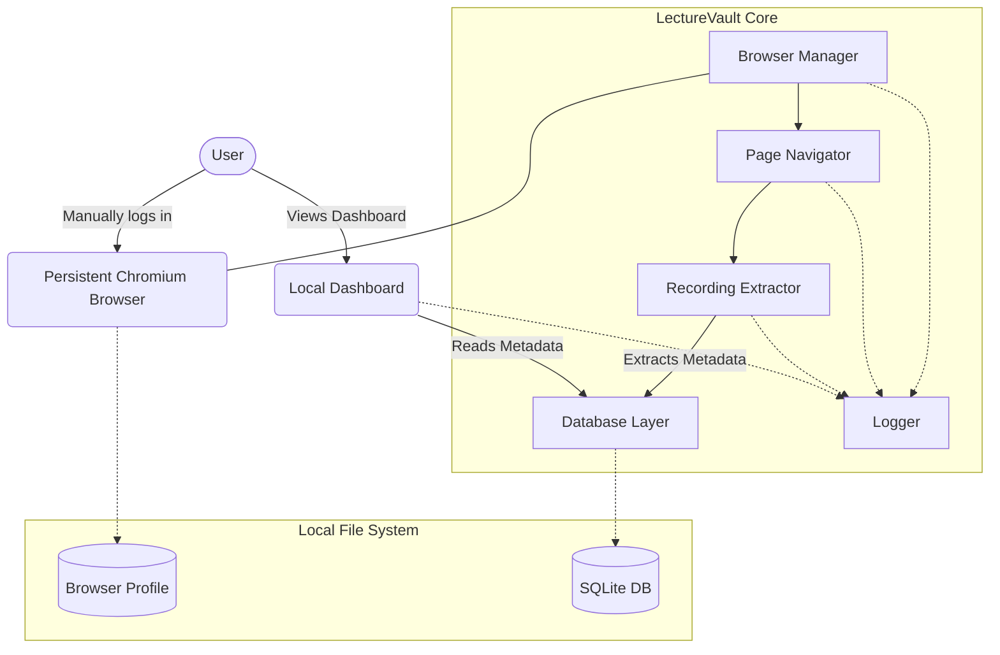
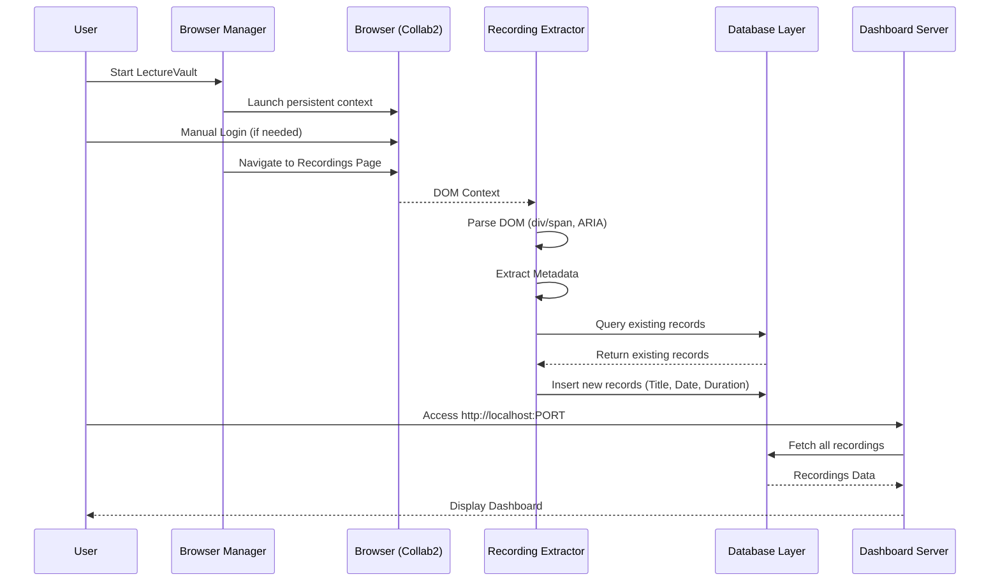

# LectureVault Architecture

## 1. System Overview

LectureVault is a local-first academic recording assistant. The primary goal is to automate the discovery and archival of university lecture recordings without compromising user privacy or violating institutional terms of service. The application operates entirely locally, utilizing a persistent browser context to leverage the user's manual authentication.



## 2. Component Breakdown

### Browser Manager
Responsible for launching and maintaining the Playwright Chromium instance. It ensures the browser uses a persistent user data directory (`./data/browser-profile/`) so that manual logins (e.g., to Blackboard Learn) persist across sessions. It configures the browser for visibility (headless mode disabled for user interaction) and manages context teardown on exit.

### Page Navigator
Handles traversal from the institutional landing page to the specific Blackboard Collaborate (Collab2) recordings pages. It relies on resilient selectors and waits for dynamic content (lazy-loaded elements) to render before proceeding. It does *not* handle authentication; it expects an active session.

### Recording Extractor
The core scraping component. It parses the Collab2 recordings lists. Since Collab2 utilizes complex, dynamic DOM structures (div/span layouts, ARIA roles, proprietary CSS classes) rather than standard HTML tables, this component relies on robust DOM traversal and role-based locators to extract:
- Recording Title
- Creation Date
- Duration
- Playback link/button reference

### Database Layer
A local SQLite integration (via `better-sqlite3`) that stores extracted metadata. It acts as the source of truth for the application, enabling it to distinguish between new and previously processed recordings.

### Dashboard Server
A lightweight Express server serving static HTML/JS. It queries the Database Layer to present a unified view of all discovered recordings to the user.

### Logger
A structured logging facility using `pino`. It records application state, navigation milestones, and extraction errors. In case of page traversal or extraction failures, it triggers screenshot captures for debugging purposes.

## 3. Data Flow Diagram



## 4. Directory Structure

```text
lecturevault/
├── src/
│   ├── browser/          # Browser Manager & Page Navigator
│   ├── extractor/        # Recording Extractor logic
│   ├── db/               # Database Layer and schema
│   ├── server/           # Dashboard Server (Express)
│   ├── utils/            # Logger, config, helpers
│   └── index.ts          # Application entry point
├── tests/                # Unit (Vitest) and E2E (Playwright) tests
├── public/               # Static assets for Dashboard (HTML/CSS/JS)
├── data/                 # EXCLUDED FROM VERSION CONTROL (.gitignore)
│   ├── browser-profile/  # Chromium user data directory
│   ├── screenshots/      # Error screenshots
│   └── lecturevault.db   # SQLite database
├── docs/                 # Documentation (Architecture, setup)
├── .env                  # Environment configuration
├── .gitignore            # Strict exclusions for /data, .env, node_modules
├── package.json
└── tsconfig.json
```

## 5. Technology Stack and Versions

- **Runtime:** Node.js (v18+)
- **Language:** TypeScript (v5+)
- **Automation/Scraping:** Playwright (`@playwright/test`, `playwright` v1.40+)
- **Database:** SQLite (`better-sqlite3` v9+)
- **Web Server:** Express.js (v4+)
- **Logging:** Pino (`pino`, `pino-pretty` v8+)
- **Testing:** Vitest (v1+) for unit tests, Playwright Test for E2E.

## 6. Configuration Management

Application configuration is managed via a `.env` file (strictly gitignored). Key configurations include:

```env
# Server
PORT=3000

# Playwright
HEADLESS=false # Must be false for manual login

# Logging
LOG_LEVEL=info

# URLs
INSTITUTION_LOGIN_URL=https://learn.university.edu
```

*Note: No credentials (usernames/passwords) are ever stored in `.env` or anywhere else.*

## 7. Security Boundaries and Constraints

- **Credential Isolation:** The application absolutely **never** touches, records, or stores user credentials. All authentication is performed manually by the user within the visible Chromium window.
- **Read-Only Interaction:** The application's scripts are restricted to read-only DOM operations on the academic portal. It will never submit forms, modify content, send messages, or interact with assessments.
- **Data Locality:** All extracted metadata, browser profiles, and application logs remain exclusively on the user's local filesystem (`./data/`). No telemetry or data is sent to external servers.
- **No DRM Bypass:** The application extracts metadata only. In future milestones involving media, it will not attempt to bypass DRM or access unauthorized streams.

## 8. Future Milestone Placeholders

- **Milestone 2 (Media Acquisition):** Integration with FFmpeg to capture raw streams (where permitted and unencrypted) directly from the authenticated browser context without downloading proprietary media files directly.
- **Milestone 3 (Local Transcription):** Integration with a local `faster-whisper` service to generate searchable transcripts of captured audio, stored locally in the SQLite database.
- **Milestone 4 (Advanced Search & Archival):** Full-text search capabilities in the Dashboard over generated transcripts, and automated local archival structures for long-term storage.

## 9. Key Design Decisions and Rationale

- **Persistent Browser Context:** chosen over API reversing or headless scraping because institutional SSO (SAML, OAuth) is notoriously difficult to automate securely and reliably. A persistent profile lets the user handle 2FA and captchas naturally.
- **Playwright over Puppeteer:** Playwright provides superior auto-waiting, robust ARIA locator support (critical for Collab2's complex div-based UI), and seamless multi-context management.
- **SQLite (better-sqlite3):** Provides a zero-configuration, transactional, local database perfect for a single-user desktop application, avoiding the overhead of running a separate database server.
- **Structured Logging (Pino) + Screenshots:** Given the fragility of DOM scraping (especially on proprietary LMS platforms), comprehensive logs and visual snapshots of failures are critical for maintenance and debugging.
