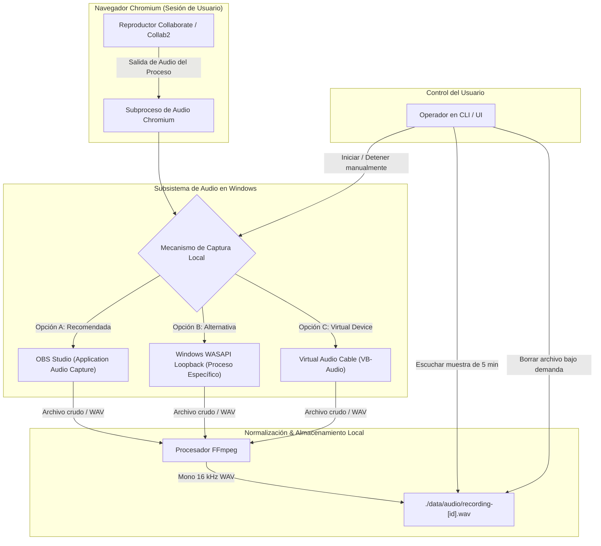

# Arquitectura del Hito 3: Captura de Audio Local

Este documento detalla el diseño técnico para la captura de audio en el **Hito 3** cumpliendo estrictamente con los principios de seguridad de **LectureVault**:
- **Cero reconstrucción o descarga de streams** (no se intercepta CloudFront, ni HLS, ni DASH, ni tokens).
- **Cero acceso a URLs privadas** ni elusión de DRM.
- **Captura acústica / salida de aplicación local:** El audio se obtiene únicamente del sonido que la aplicación de navegador emite a través de Windows.

---

## 1. Diagrama de Flujo de Datos

---

## 2. Restricciones de Seguridad Obligatorias

1. **Sin extracción de red:** No se analizan paquetes de red ni peticiones HTTPS a CloudFront ni CDNs.
2. **Sin micrófonos:** La entrada de micrófono debe estar **deshabilitada por defecto** para evitar grabar audio ambiental o privacidad del usuario.
3. **Aislamiento por aplicación:** La captura debe limitarse al proceso del navegador (`chrome.exe` / `msedge.exe`), evitando capturar sonidos del sistema o notificaciones de otras aplicaciones.
4. **Tiempo acotado:** La prueba de concepto manual está limitada estrictamente a **5 minutos de muestra**.
5. **Formato objetivo normalizado:** Archivo WAV en canal mono a **16.000 Hz (16 kHz)**, el estándar óptimo que requiere Whisper para procesar tokens acústicos sin desperdiciar CPU.
6. **Retención local y supresión:** El usuario puede escuchar la muestra generada y eliminarla inmediatamente si lo desea.
